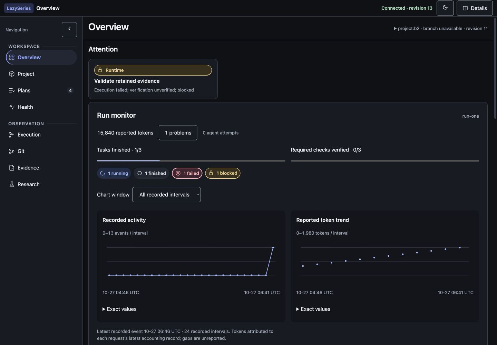
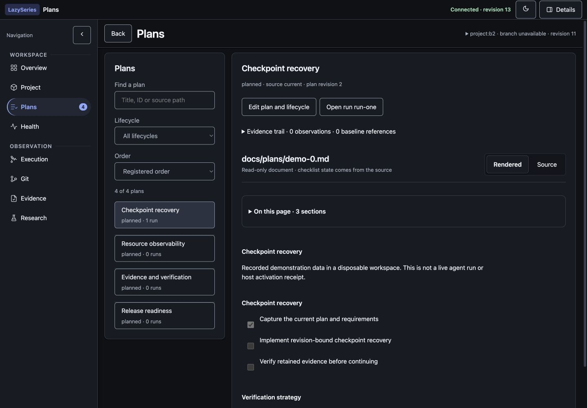
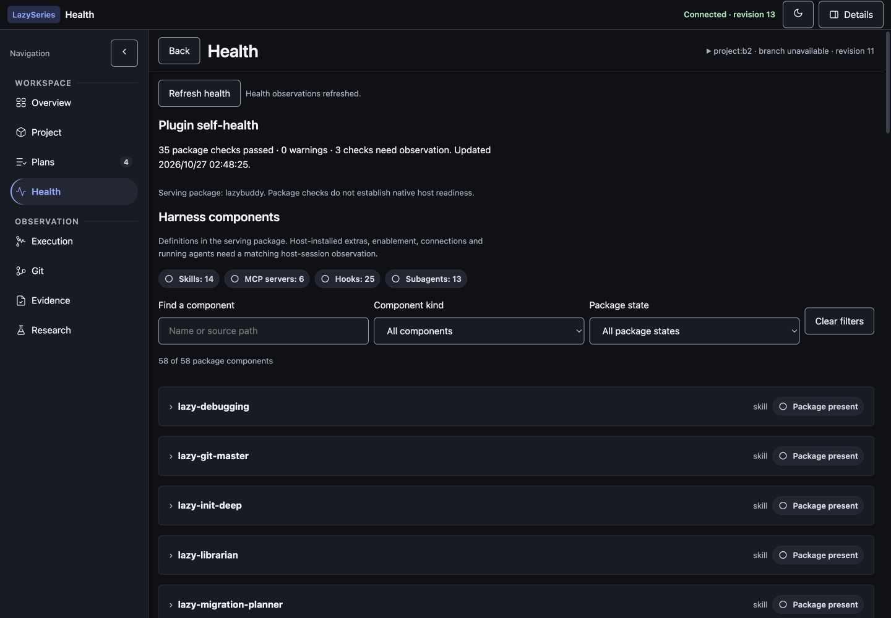

# LazyBuddy

Verification and bounded execution require **Python 3.11 or newer**.


[](RELEASE_NOTES.md)
[](LICENSE)
[](#lazyseries-family)

**Describe the work. Keep the plan. Prove the result.**

LazyBuddy helps you use structured, evidence-based workflows in **CodeBuddy
CLI**, **CodeBuddy IDE**, and **WorkBuddy**. It prepares local package assets
and guidance; a host is only considered ready after it is observed in a fresh
session.

[Platform status](docs/reference/platform-status-2026-10-30.md) · [Get started](#recommended-install-with-ai-help) · [Host routes](#choose-one-route) ·
[1.4.0 notes](RELEASE_NOTES.md) · [Family](#lazyseries-family) · [Docs](docs/)

> **Current package version: v1.4.0. HOST READINESS: PENDING.** Local checks and release
> archives prove package behavior; a fresh host session must prove loading,
> command/skill execution and MCP connections.

## Unreleased 1.4.1 — verification, history and scale

The combined former 1.4.1 and 1.4.2 scope is implemented in this development branch. Package metadata and the published baseline remain **1.4.0**; this PR does not publish a release. Live-host acceptance is **deferred by the maintainer as of 2026-10-30**, and remains pending.

- Retain versioned verification scenarios, compare attempts by their source/criterion/plan subject, and promote an observed failure into an unverified regression scenario.
- Bind rerun review to the exact plan, criterion and captured source. Pending, rejected, stale and used approvals cannot authorize another native attempt; independent verification remains required.
- Inspect checkpoint/decision history through authenticated, paginated reads. Deduplicate identical runtime events with transactional recovery while retaining the original ledger and failed attempts.
- Preserve first-review plan bytes, correct legacy review-state updates, and harden owned-process cleanup against PID reuse and exit races.
- Reduce repeated replay and unnecessary review-source capture in measured local cases. These measurements do not establish whole-task latency, token or cost savings.

See the [1.4.1 completion and validation record](docs/verification/1.4.1-completion.md) and [usage/contracts](docs/verification/1.4.1-verification-history.md).

## What's in 1.4.0

- An authenticated local dashboard with eight destinations: **Overview, Project,
  Plans, Health, Execution, Git, Evidence and Research**.
- A project record, editable plans, queue planning and research capture, with
  source revisions and evidence references visible for review.
- A run monitor that separates execution progress from verified completion,
  plus reported token usage, resource activity and retained-run history.
- A Health inventory of package components, separate from observed host activity.

The `status-dashboard` MCP server exposes seven tools, including
`dashboard_service`, `copy_task_context` and typed `project` operations.

The release builds on the existing planning, decision-memory and verification
workflows described below. No speed, token-saving or cost improvement is
claimed. See the [release notes](RELEASE_NOTES.md) for compatibility and upgrade
boundaries; historical changes remain in `CHANGELOG.md`.

## Browser dashboard (v1.4.0)

After explicit project initialization, the dashboard provides **Overview,
Project, Plans, Health, Execution, Git, Evidence and Research** in a collapsible
sidebar. Contextual Details keep the selected item in view; maps support pan,
zoom and an expanded modal. Theme preferences persist, and
navigation guards protect unsaved edits.

Execution progress and verification are separate. Token charts, resource
activity and retained-run comparisons show available records; missing usage
remains unknown. Health lists package Skills, commands, agents, hooks and MCP
components without treating that inventory as host activation.

Plans and research expose source revisions and evidence references. A hash
reference does not preserve an immutable copy of its source or verify a
finding. Source edits require authentication, the correct native project
binding and a matching revision; stale edits conflict instead of overwriting
newer work. Queue edits never start execution.

The service binds to authenticated loopback, and each repository keeps its own
project state. Browser access, transactional edits, queue planning, context
copy and observations are package capabilities. Host embedding, chat handoff
and wake remain unobserved; **HOST READINESS: PENDING** still applies.

The portable dashboard and project cores are pinned in
`lazybuddy-plugin/shared/dashboard.vendor.json` and
`lazybuddy-plugin/shared/project.vendor.json`. The
[documentation index](docs/README.md) covers package architecture and usage.

### Dashboard gallery

Recorded demo data served by the native local dashboard; not a live host-session receipt.

**Overview** — execution and verification progress, recorded activity and the project map.



**Plans** — plan records, source context and revision-aware review.



**Health** — package component inventory, separate from observed host activity.



### Just ask, or use a command — both work

Two entry routes converge on the same execution authority and gates:

- **Natural language**: describe the work plainly — "Fix the typo in the
  welcome label" — and the smallest sufficient workflow is selected and run.
- **Explicit commands**: `/lazy-ulw-plan <idea>` builds a new plan, and
  `/lazy-start-work <plan>` executes a known plan. Same authority, same gates.

No slash command is required for a clear implementation request. Conversely,
asking to *explain*, quoting a command, or saying "plan only" never touches
your files: the persisted `execution_intent` stays `plan_only` until you
actually ask for execution, and a vague "ok" with several open questions never
grants execution by itself.

### Plans you can edit while work runs

Plans are Markdown you own. Edit them mid-run; the harness reconciles your
changes at execution boundaries instead of overwriting them:

- Cosmetic wording and ordering edits preserve existing evidence.
- Semantic edits (acceptance, dependencies, verification commands) invalidate
  only the affected task and its dependents — unrelated work is untouched.
- Your checkbox is an *assertion*, not a verdict: a checked box alone never
  counts as verified completion, and unchecking reopens the task.

### Decisions the harness remembers

Cross-plan decisions live in a durable ledger (`.lazybuddy/decisions/ledger.jsonl`).
When plan two hits a question plan one already answered — with evidence — it
recalls the decision instead of re-asking you. Contradictions are surfaced as
supersessions, defects become scoped corrections that block only the affected
work, and nothing in memory can override your current instructions.

### Verification sized to the change

The workflow calls for verification sized to the change: a documentation
inspection (V0), a focused check (V1), an integration scenario (V2), or a
comprehensive security/release gate (V3, normally in CI). Valid evidence may be
reused while its inputs match; affected, missing or stale checks must rerun.
Native execution still needs acceptance in the selected host.

Milestones, decision gates, and full state/version semantics are shared
byte-identically with LazyTrae and LazyQoder (see
`lazybuddy-plugin/contracts/lazyseries-shared-semantics.v1.json`).


## Recommended: install with AI help

You do not need to manually work through every setup detail. Open an AI coding
assistant in your project and paste this:

> Help me install LazyBuddy from https://github.com/elvinzhao10/LazyBuddy for
> this project. Use v1.4.0 and follow AGENTS.md and the current install guide. Run safe package checks first,
> explain each step plainly, and ask me before changing marketplace, plugin,
> Skills, MCP, account, credential, or trust settings.

The assistant can guide onboarding, but you approve every host-managed change.

## Manual setup

Manual setup is available when you prefer complete control. You need
**Node.js LTS 24 (recommended) or 22 (supported alternative)** and **Git**, plus **Python 3.10+** available as `python3`. The lifecycle also accepts Node.js LTS 20 for compatibility. Start from the verified origin
`https://github.com/elvinzhao10/LazyBuddy` and follow the
[installation guide](docs/03-install-and-host-verification.md).

Run `onboard` once to create a durable installation. After that, use the stable
launcher for `update`, `status`, and safe `offboard`:

```text
node "<install-root>/LazyBuddy/launcher.js" status
```

## What “ready” means

- **Package readiness** means the copied package and local checks are valid.
- **Host readiness** needs a fresh host session, one real Skill or command,
  and every expected MCP connection.

Until that is observed, the honest result is **HOST READINESS: PENDING**.
Local files and load checks never prove that a host loaded the plugin.

The default package doctor does not discover or execute `codebuddy` from
`PATH`. Optional host-manifest validation is an explicit action using
`bash scripts/lazybuddy-plugin-doctor.sh --host-validator /absolute/path`.
The release verifier runs classified shell regressions serially, all package
`tests/*.test.js` with conservative Node concurrency, and Python tests under
`tests/` and `tooling/`; its JSON names those outcomes separately.

## Choose one route

Pick one host route during onboarding:

- **CodeBuddy CLI** uses the documented local marketplace route.
- **CodeBuddy IDE** uses that marketplace route when the CLI is available.
- **WorkBuddy** uses its full-plugin marketplace route.

Skills plus manual MCP connectors are a recovery-only option. Do not run that
fallback beside a full-plugin route for the same project. Stop the session,
remove only LazyBuddy's previous entries through the host UI, choose one route,
and start a new session to verify it.

## Design mindset

Start with the result you want and how you will know it worked. Then use the
smallest amount of structure that fits the task. You can simply describe the
work in plain language; the modes are guidance, not commands you need to
memorize. The v1.3.0 dual-entry routing picks one of these for you.

| Mode | Use it when | Example request |
| --- | --- | --- |
| Direct | The change is small and clear. | “Fix this error and run the relevant test.” |
| Assisted | You need help understanding an unfamiliar area or failure. | “Help me find why this command fails, then verify the fix.” |
| Planned | The work has several parts or important choices. | “Make a plan for this feature before changing files.” |
| Orchestrated | The work affects a release, security, or a risky change. | “Review this release and prepare it for publication.” |
| Long-horizon | The goal needs to continue across sessions. | “Keep working on this migration with checkpoints.” |

## Keep host changes deliberate

LazyBuddy does not automate credentials, OAuth values, private registries, or
trust settings. It asks for approval before any host-managed action and keeps
safe package checks separate from marketplace and connector changes.

## Package inventory

These counts describe shipped definitions and declarations, not loaded host
components.

| Surface | Count | Role |
| --- | ---: | --- |
| Skills | 14 | Host-facing workflow policies for planning, execution, review, and verification. |
| Commands | 14 | Named host entry points for those workflow policies. |
| Agents | 13 | Specialist role definitions for planning, implementation, QA, security, and context. |
| MCP declarations | 6 | Local services for ledger, verification, status, context, code intelligence, and docs. |

## LazySeries family

**One workflow philosophy. Six host integrations.** Choose the sibling for the
host you use; each keeps its own native adapters, installation route and
acceptance evidence. These packages run independently.

| Sibling | Target host |
| --- | --- |
| [LazyBuddy](https://github.com/elvinzhao10/LazyBuddy) **← you are here** | CodeBuddy CLI / IDE · WorkBuddy |
| [LazyTrae](https://github.com/elvinzhao10/LazyTrae) | TraeCode / TraeWork / TraeCode CLI |
| [LazyQoder](https://github.com/elvinzhao10/LazyQoder) | Qoder CLI / IDE / app |
| [LazyZCode](https://github.com/elvinzhao10/LazyZCode) | ZCode |
| [LazyKimi](https://github.com/elvinzhao10/LazyKimi) | Kimi Code CLI · Kimi Work (experimental) |
| [LazyDeepSeek](https://github.com/elvinzhao10/LazyDeepSeek) | DeepSeek Harness 0.2.1-rc.3 |

The family shares planning, evidence, decision-memory and completion contracts.
The shared verification core and the portable dashboard core are vendored
byte-identically in every package (LazyBuddy is the vendoring source); product
adapters keep host setup and permissions explicit. Matching contracts do not
make host capabilities interchangeable. In particular,
Kimi Work remains experimental for LazyKimi, and DeepSeek's synthesized events
are not native hooks. Use each sibling's host guide before installation.

## Technical reference and evaluation

The source-level explanation lives in [docs/README.md](docs/README.md). It
maps the package structure, request flow, state model, security boundaries,
MCP lifecycle, and release checks with diagrams tied to the implementation.

For a capability-by-capability comparison with the original LazyCodex design,
including what LazyBuddy implements and where it intentionally differs, see
[lazybuddy-evaluation.md](lazybuddy-evaluation.md).

LazyBuddy is primarily inspired by LazyCodex
([upstream project](https://github.com/code-yeongyu/lazycodex)). Its
relationship to OmO and upstream sources is recorded in [NOTICE](NOTICE).
It is an independent implementation and does not require LazyCodex or OmO at
runtime.

## Learn more

- [Install and verify a host](docs/03-install-and-host-verification.md)
- [Remove receipt-owned assets safely](docs/08-safe-removal.md)
- [Browser dashboard service and boundaries](docs/reference/dashboard-service.md)
- [Workflow playbooks — how the modes pick work](docs/04-workflow-playbooks.md)
- [Evidence and completion — what "done" proves](docs/05-evidence-and-completion.md)
- [State and validation — how plan edits reconcile](docs/07a-state-and-validation.md)
- [Host routes and recovery](docs/reference/host-routes.md)
- [Release notes](RELEASE_NOTES.md)
- [Documentation index](docs/README.md)

## License

[MIT](LICENSE). See [NOTICE](NOTICE) for attribution and provenance.

## Contributing

Issues and pull requests are welcome. Read [CONTRIBUTING.md](CONTRIBUTING.md)
for development checks, release expectations, and guidance for reporting
sanitized reproduction details. Report vulnerabilities privately according to
[SECURITY.md](SECURITY.md).
