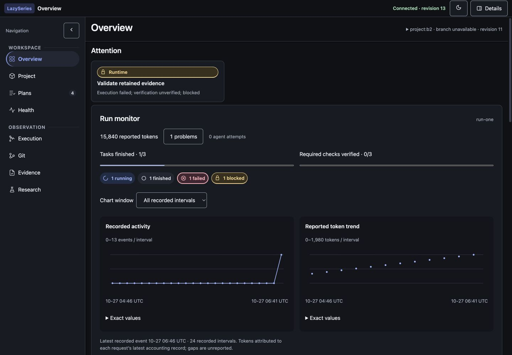
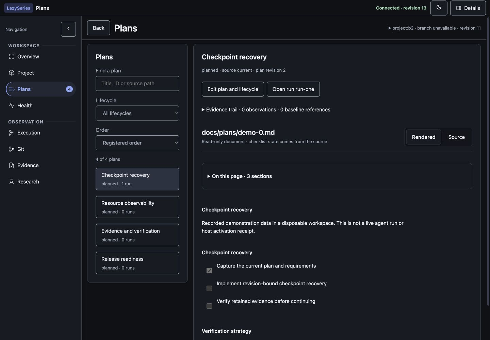
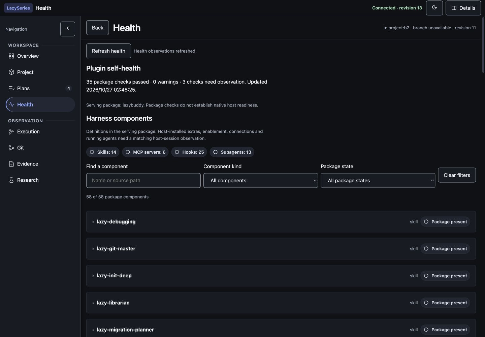

# LazyBuddy


[](https://github.com/elvinzhao10/LazyBuddy/releases/latest)
[](https://github.com/elvinzhao10/LazyBuddy/actions/workflows/ci.yml)
[](LICENSE)

**Plan, build, and verify in CodeBuddy and WorkBuddy.**

Turn coding requests into focused work, editable plans, and results you can check. Small changes stay direct. Larger tasks get the structure they need.

[Get started](#get-started) · [Dashboard](#dashboard) · [Host setup](#host-setup) · [Documentation](docs/README.md) · [Release notes](RELEASE_NOTES.md)

## Work you can pick up again

| You want to… | LazyBuddy helps you… |
| --- | --- |
| Fix something small | Make the change and run a focused check. |
| Build something larger | Keep an editable Markdown plan with tasks and checkpoints. |
| Know what actually passed | Review verification results and the evidence behind them. |
| Continue later | Resume with project decisions, context, and progress intact. |

## Dashboard

See project plans, execution progress, verification, Git activity, evidence, and research in one local browser dashboard. Execution and verified completion are shown separately.



*Local browser dashboard with recorded demo data.*

<details>
<summary>Explore Plans and Health</summary>

**Plans** — review tasks, source context, and revisions.



**Health** — inspect the package’s components and available observations.



</details>

## Get started

**Requirements:** Node.js **24** (recommended) or **22**, Git, and **Python 3.11+**.

Choose your app in the [installation guide](docs/03-install-and-host-verification.md). For guided setup, paste this into your coding assistant:

```text
Help me set up LazyBuddy for this project:
https://github.com/elvinzhao10/LazyBuddy
Follow AGENTS.md and the installation guide for my app.
Explain the setup and confirm the integration in a fresh session.
```

Prefer manual setup? Follow the same [step-by-step guide](docs/03-install-and-host-verification.md). After loading the integration, try a small request:

```text
Fix the failing test and run the relevant checks.
```

## Use the amount of structure you need

| Task | Try asking |
| --- | --- |
| A clear fix | “Fix this error and verify the change.” |
| A larger feature | “Make a plan before changing files.” |
| A review | “Review this diff and explain the remaining risks.” |
| Ongoing work | “Continue from the last checkpoint.” |

You can also use `/lazy-ulw-plan <goal>` and `/lazy-start-work <plan>` where your app exposes the packaged commands. Plans remain yours to edit, and remembered decisions do not override your current instructions.

[Workflow guide](docs/04-workflow-playbooks.md) · [Verification and completion](docs/05-evidence-and-completion.md)

## Host setup

| Client | Integration |
| --- | --- |
| CodeBuddy CLI / IDE | Native marketplace integration. |
| WorkBuddy | Full-plugin support depends on the app build; Skills and MCP are available as a recovery route. |

App capabilities vary by version and client. Use the [host guide](docs/reference/native-integration-1.4.1.md) for compatibility and setup. The local browser dashboard is separate from the host app.

## Documentation

- [Install and verify your integration](docs/03-install-and-host-verification.md)
- [Everyday workflows](docs/04-workflow-playbooks.md)
- [Dashboard and package capabilities](docs/README.md)
- [Update, recover, or remove an installation](docs/reference/host-routes.md)
- [What changed in 1.4.1](RELEASE_NOTES.md)

## LazySeries family

Choose the integration for your coding app. Each package runs independently.

| Project | Host |
| --- | --- |
| [**LazyBuddy**](https://github.com/elvinzhao10/LazyBuddy) | CodeBuddy · WorkBuddy |
| [LazyTrae](https://github.com/elvinzhao10/LazyTrae) | TRAE |
| [LazyQoder](https://github.com/elvinzhao10/LazyQoder) | Qoder |
| [LazyZCode](https://github.com/elvinzhao10/LazyZCode) | ZCode |
| [LazyKimi](https://github.com/elvinzhao10/LazyKimi) | Kimi Code · Kimi Work (experimental) |
| [LazyDeepSeek](https://github.com/elvinzhao10/LazyDeepSeek) | DeepSeek Harness |

## Contributing

[Contributions](CONTRIBUTING.md) and issues are welcome. Report security concerns through [SECURITY.md](SECURITY.md).

Inspired by [LazyCodex](https://github.com/code-yeongyu/lazycodex). See [NOTICE](NOTICE) for attribution. Licensed under [MIT](LICENSE).
